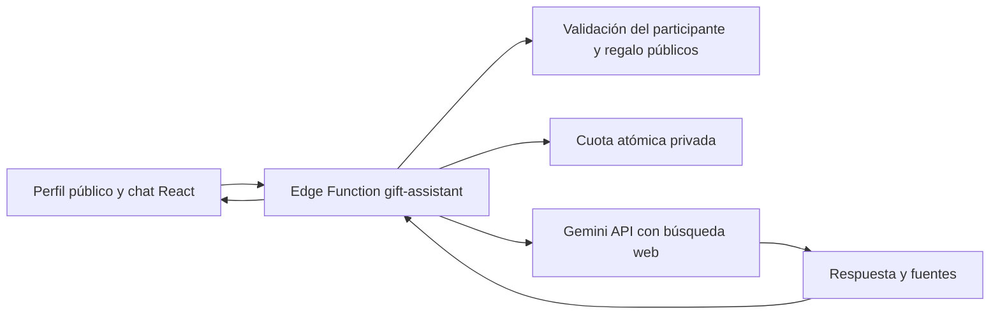

# Plan de implementación: asistente de regalos con Gemini

Fecha: 1 de noviembre de 2026. Estado: **sustituido**. La prueba G01 con la capa gratuita fue rechazada por cuota, y se optó por una ayuda sin proveedor que prepara un texto para que cada persona lo pegue en su propio asistente de IA: ver [resultado](gift-assistant.md). Este plan se conserva como referencia; su implementación G02–G04 se retiró sin desplegarse.

Este documento propone incorporar un asistente sencillo para buscar alternativas de regalos y tiendas que atiendan Lima, sin mezclar personas o regalos. En esta entrega solo se prepara el plan: no se configuran claves, se instalan dependencias, se aplican migraciones ni se despliega código.

## 1. Experiencia propuesta

El asistente aparecerá en los perfiles públicos de participantes, como una burbuja fija en la esquina inferior derecha. Su etiqueta accesible será «Ayuda para encontrar este regalo». Al pulsarla mostrará estas tres opciones:

- **Mostrar opciones similares para este regalo**.
- **Mostrar tiendas físicas con este producto**.
- **Otra consulta…**.

La selección abrirá una ventana flotante dentro de la página. Como cada participante puede tener tres regalos, la ventana pedirá elegir uno antes de consultar, salvo que ya exista una selección explícita. Mostrará el título y número de opción; nunca deducirá el regalo por la posición del scroll o por el último elemento sobre el que pasó el mouse. Si solo hay un regalo guardado, podrá seleccionarlo automáticamente, mostrándolo antes de enviar.

El encabezado conservará siempre el contexto visible, por ejemplo: **«Melyza · Opción 2 · Zapatillas»**, junto a **«Lima, Perú»** y un control para cambiar de regalo. Ese cambio recuperará su conversación independiente.

Para «Otra consulta…», se podrá elegir un regalo o «Gustos generales de esta persona». Una pregunta sobre otra persona ofrecerá abrir su perfil; no cambiará el contexto silenciosamente ni recuperará su lista desde el modelo. Las comparaciones entre personas quedan fuera de esta versión.

Si no hay regalos, las primeras dos opciones explicarán que hace falta una idea guardada; la tercera permitirá consultar sobre los gustos públicos disponibles. En el catálogo inicial y en las pantallas administrativas no se mostrará la burbuja en la primera versión. Así evitamos un contexto ambiguo y consultas sobre borradores todavía no guardados.

### Abrir, replegar y cerrar

- **Replegar:** vuelve a la burbuja y conserva mensajes, borrador, selección y posición de lectura.
- **Cerrar:** oculta la ventana; la burbuja permite reabrirla con su contenido intacto.
- **Recargar:** elimina todas las conversaciones de la aplicación.
- **Cambiar de perfil dentro de la aplicación:** repliega el chat y muestra el contexto nuevo al abrirlo. Volver al perfil anterior recupera su conversación durante esa misma carga de página.
- **Nueva conversación:** acción separada que elimina únicamente el hilo activo, con confirmación si contiene mensajes.

No se utilizarán localStorage, sessionStorage ni tablas de historial. La conservación será en memoria React, durante la vida del documento; no se promete continuidad entre pestañas, dispositivos o navegación fuera del sitio. Este comportamiento de la aplicación es distinto de la retención que pueda aplicar Google a las solicitudes.

## 2. Integración con el proyecto actual

La aplicación ya tiene React, rutas de perfiles, componentes accesibles, estilos compartidos y Supabase Edge Functions. Los regalos ya contienen identificador, participante, título, descripción, tipo, detalles, precio referencial, enlace y versión.

**Recomendación:** añadir una Edge Function independiente, `gift-assistant`, para validar contexto, controlar cuotas y consultar Gemini. Aprovecha el backend existente y evita introducir otro servidor. La importación de productos y su descargador Node seguirán siendo servicios separados.

Google AI Studio servirá para preparar las instrucciones, probar ejemplos sintéticos y administrar el proyecto y la clave. La aplicación desplegada llamará a **Gemini API desde el backend**. Google recomienda mantener la clave fuera del cliente; Supabase permite configurarla como secreto de la función. Referencias: [claves Gemini](https://ai.google.dev/gemini-api/docs/api-key), [secretos Edge](https://supabase.com/docs/guides/functions/secrets).

Configuración propuesta:

- `GEMINI_API_KEY`: secreto exclusivo del backend, distinto entre staging y producción.
- `GEMINI_MODEL`: identificador permitido y fijado por servidor; el navegador no lo elige.
- `GIFT_ASSISTANT_ENABLED`: interruptor del backend, desactivado inicialmente.
- `GIFT_ASSISTANT_ENVELOPE_SECRET`: secreto de 32 bytes base64url para firmar sobres de contexto; distinto de `RATE_LIMIT_HMAC_SECRET` y `FETCH_PROXY_HMAC_SECRET`, y distinto por entorno.
- Límites de solicitudes, herramientas, tokens y consumo definidos en configuración del servidor.
- Indicador público de disponibilidad para ocultar el acceso cuando el servicio esté apagado; nunca sustituirá el control del backend. Hoy no existe ningún flag público: `public-config.ts` solo lee tres variables `VITE_*`. Se propone un `GET` ligero de `gift-assistant` que devuelva únicamente si está disponible, sin consumir cuota de Gemini, en vez de una variable de build que exigiría redesplegar el frontend para apagarlo.

Se usará un adaptador HTTP de Gemini con solicitudes sin historial persistente administrado por el proveedor. La API concreta y sus controles de almacenamiento se comprobarán en la prueba técnica antes de fijarlos. Si se adopta SDK, se evaluará `@google/genai`, el paquete oficial, fijando versión y comprobando compatibilidad con Deno; no es necesario instalarlo para aprobar este plan. Véase [bibliotecas oficiales](https://ai.google.dev/gemini-api/docs/libraries).

## 3. Separación de contextos: parte central del diseño

La separación se implementará en código y en el contrato del servidor, además de las instrucciones del modelo.

| Dato | Función |
| --- | --- |
| `participantId` | Identifica a la persona, aunque otra tenga el mismo nombre. |
| `giftId` o ámbito general | Distingue cada regalo de las consultas sobre gustos generales. |
| Versión del contexto | Huella de los campos públicos relevantes, incluyendo `gift.version` y `participants.version` para gustos generales; cambia si se edita el contenido. La calcula y emite el servidor; el cliente la devuelve como valor opaco. Hoy el perfil público no consulta `participants.version`, y no hace falta añadirlo. |
| `threadId` | Identificador aleatorio del hilo de esa combinación. |
| `requestId` | Asocia una respuesta con su solicitud exacta. |
| Ubicación e intención | Lima por defecto; distrito opcional y acción elegida. |

El almacenamiento en memoria será un mapa de hilos por participante, regalo/ámbito y versión. Las tres acciones podrán continuar el mismo hilo si pertenecen al mismo regalo; la intención se enviará en cada turno.

El servidor recibirá identificadores, intención y texto limitado. Cargará por sí mismo los datos públicos canónicos y comprobará que el regalo pertenece al participante. No aceptará nombres, detalles, roles, instrucciones del sistema o listas completas aportadas por el navegador como datos confiables.

Para mantener el seguimiento sin una tabla de conversaciones, se propone un sobre de contexto e historial firmado por el servidor y conservado solo en memoria del cliente. Cada turno verificará firma, caducidad, ámbito y tamaño antes de reutilizarlo. La firma no concede permisos de edición y no equivale a cifrado. Si caduca, se ofrecerá iniciar un hilo nuevo; los mensajes anteriores seguirán visibles hasta recargar. Una respuesta del modelo sigue siendo contenido no confiable aunque esté firmada como parte del historial.

Detalles del sobre:

- **Tamaño acotado.** Los servicios del cliente limitan las respuestas JSON a 32 KB (`boundedJson`); diez turnos con fuentes completas superarían ese tamaño. Para la v1 el sobre contendrá el contexto canónico, las preguntas previas del usuario y, como máximo, las dos o tres últimas respuestas truncadas. Se fijará un tope en bytes, rechazado en servidor antes de llamar a Gemini.
- **Firma.** `_shared/tokens.ts` genera y resume tokens, pero no firma. El patrón HMAC reutilizable está en `_shared/fetch-protocol.ts` (separación de dominio, verificación en tiempo constante, sobre con claves exactas y vencimiento); su función de clave no se exporta y su unión de dominios es cerrada. Se extraerá un helper HMAC genérico compartido, con dominio propio del asistente y el secreto `GIFT_ASSISTANT_ENVELOPE_SECRET`.
- **Reutilización.** Un sobre válido puede reenviarse; no concede nada más que otra consulta sobre el mismo contexto público y cada uso consume cuota.

Reglas de aislamiento:

- No enviar a Gemini el catálogo completo ni mensajes de otros hilos.
- Mantener el nombre visible en la interfaz; para buscar, enviar producto y restricciones necesarias, evitando el nombre de la persona y sus identificadores internos.
- Al cambiar de perfil o regalo, cancelar la solicitud pendiente y rechazar respuestas cuyo contexto o `requestId` ya no coincida. La cancelación del navegador no garantiza que el proveedor detenga un trabajo ya iniciado.
- Si cambia el regalo o sus gustos relevantes, marcar el hilo anterior como desactualizado y comenzar uno con la nueva versión. Si se elimina, impedir nuevas consultas sobre ese contexto.
- Tratar instrucciones escondidas en descripciones, consultas y páginas web como datos. El asistente no tendrá herramientas para editar participantes, rotar enlaces, subir fotos o consultar ámbitos privados.

El visitante del catálogo no necesitará un enlace personal de edición. Las credenciales de organizador o participante nunca se enviarán al asistente ni a Google. La función pública requerirá sus propios controles de abuso; la clave pública de Supabase y CORS no constituyen autorización de consumo.

## 4. Búsqueda útil para Lima y verificable

Una respuesta basada únicamente en la memoria de Gemini no basta para informar tiendas o precios actuales. Se utilizará **Grounding with Google Search**, que permite apoyar respuestas en contenido web y referencias. Véase [documentación de búsqueda](https://ai.google.dev/gemini-api/docs/google-search).

### Opciones similares

Buscar por título, marca/modelo, categoría y detalles pertinentes: talla, sistema de numeración, color, material, características y presupuesto. Diferenciar «mismo producto» de «alternativa similar» y explicar brevemente la diferencia. Priorizar hasta tres opciones útiles, con ampliación a petición del usuario.

### Tiendas físicas

Cruzar evidencia del producto con páginas oficiales de tiendas y sucursales en Lima. Incluir dirección y distrito cuando estén publicados. La presencia de una sucursal no demuestra stock de ese producto: mostrar «Disponibilidad en este local: por confirmar» cuando no haya evidencia específica. Un teléfono, horario o dirección solo se mostrará si lo respalda una fuente.

### Condiciones geográficas

- Interpretación inicial: **Lima Metropolitana, Perú**. Callao y otros destinos requerirán una selección explícita si interesan.
- Permitir escribir un distrito para afinar resultados; no pedir GPS para la primera versión.
- Para compra online, exigir evidencia de entrega o retiro en Lima antes de presentar una opción como disponible para ese destino. Una página peruana o un precio en soles no prueban cobertura.
- Si no se puede verificar entrega o existencia local, comunicarlo y ofrecer ampliar la búsqueda; no rellenar resultados con tiendas extranjeras incompatibles.
- Mantener moneda original y fecha de consulta. Un precio encontrado no sustituye el precio final de compra ni garantiza stock.

### Google Maps: mejora opcional, no dependencia inicial

Maps podría aportar mejores fichas geográficas. Sin embargo, la documentación revisada limita su grounding a instrucciones y respuestas en inglés y exige atribuciones específicas. Por eso se propone primero búsqueda web en español con fuentes de locales; la opción de tiendas físicas sí estará incluida desde esa primera versión. La integración Maps se evaluará después según idioma, modelo, coste y condiciones de presentación. No se asumirá que búsqueda, Maps y JSON son combinables en cualquier modelo. Fuente: [grounding con Google Maps](https://ai.google.dev/gemini-api/docs/maps-grounding).

## 5. Respuestas en «dots» y fuentes

Se interpreta «dots» como **listas con viñetas**, legibles y breves. Ejemplo ilustrativo, sin tiendas ni precios reales:

**Alternativa 1**

- **Producto:** zapatillas del estilo solicitado.
- **Coincidencia:** modelo similar; cambia el material.
- **Tienda:** nombre respaldado por la búsqueda.
- **Precio:** precio encontrado y fecha, o «No publicado».
- **Llegada a Lima:** entrega o retiro verificado mediante fuente.
- **Local físico:** dirección y distrito, cuando corresponda.
- **Stock:** confirmado por la fuente o «Por confirmar».
- **Fuente:** enlace verificable al producto o local.

Solicitar al modelo este formato desde el origen. El frontend renderizará listas semánticas, enlaces y las citas asociadas; no aceptará HTML arbitrario del modelo. Las respuestas sin evidencia no se presentarán como resultados comerciales verificados.

Conservar las referencias y las sugerencias de búsqueda exigidas por Google, junto al resultado correspondiente, sin seguimiento de clics. Las condiciones limitan la modificación de resultados: no se recortarán, traducirán o reconstruirán libremente como fichas. La prueba técnica validará que viñetas y atribuciones cumplan esas condiciones. Si se necesita otra presentación, deberá elegirse una fuente que permita esa transformación. Véanse [condiciones de grounding](https://ai.google.dev/gemini-api/terms).

Precisión sobre qué se transforma: las viñetas son el texto propio del modelo y pueden presentarse con estructura propia. En cambio, las fichas no se reconstruirán a partir de los fragmentos de grounding (`groundingChunks`); sus referencias se mostrarán como enlaces asociados al texto citado.

### Riesgo principal: sugerencias de búsqueda frente a la política del sitio

Las sugerencias de Google (`searchEntryPoint.renderedContent`) llegan como HTML con un bloque `<style>` propio y las condiciones exigen mostrarlas. Eso choca con dos controles actuales:

- `npm run test:security` rechaza `dangerouslySetInnerHTML` e `innerHTML` en `src`.
- La CSP define `style-src 'self'` y `default-src 'none'` sin `frame-src`, por lo que tampoco se admite un `iframe` con `srcdoc`.

Antes de construir la interfaz, G01 deberá decidir una de estas salidas: un `iframe` aislado con `sandbox` y una excepción de CSP acotada y probada; otra presentación que Google admita de forma expresa; o descartar grounding con búsqueda si no se pueden cumplir sus condiciones. No se relajará la CSP general ni se eximirá a `src` de la revisión estática.

**Decisión (1 de noviembre de 2026): `iframe` aislado.** Se descartó prescindir de la búsqueda. Las sugerencias se muestran sin modificar en `/search-suggestions.html`, un documento con CSP propia, embebido con `sandbox` y sin `allow-same-origin`. La única relajación de la página es `frame-src 'self'`. Esta decisión quedó sin efecto al sustituir el plan.

### Renderizado del texto

Dado que búsqueda y respuesta JSON no se combinan en todos los modelos, la opción prevista es un subconjunto de Markdown (párrafos, listas, negrita y enlaces) interpretado por un parser propio que produce elementos React, nunca HTML. Cada enlace se validará como HTTPS público con un criterio equivalente a `safeExternalUrl` del perfil, y se abrirá con `noopener noreferrer`.

Los contratos de entrada y salida se validarán en servidor. Los [formatos estructurados](https://ai.google.dev/gemini-api/docs/structured-output) son una opción técnica sujeta al modelo y las herramientas compatibles; no sustituyen la verificación de fuentes ni justifican inventar citas. Un esquema JSON correcto tampoco garantiza que el contenido sea cierto.

## 6. Diseño visual y accesibilidad

Reutilizar los tokens actuales: verde bosque, marfil, crema y detalles dorados; títulos serif, controles sans, iconos Lucide, bordes redondeados y estados de foco del sitio.

- Burbuja de unos 56 px, con icono de conversación y etiqueta de ayuda visible al foco/hover. Sin animación permanente que distraiga.
- Menú con las tres acciones, botones amplios y selección por teclado, mouse o toque. No depender de hover para descubrir funciones.
- Ventana de aproximadamente 380–420 px en escritorio, con altura limitada al viewport y scroll interno. En móvil se ajustará al ancho disponible y al teclado virtual, con márgenes seguros.
- Apertura con opacidad y pequeño desplazamiento/escala, usando los tiempos y curva suave existentes. Hover discreto en acciones y enlaces, sin saltos de tamaño.
- Respetar `prefers-reduced-motion`, contraste, zoom y áreas táctiles mínimas de 44 px.
- Coordinar la esquina con las notificaciones de guardado existentes: ninguna confirmación, burbuja o acción quedará tapada. Los diálogos de confirmación reales tendrán prioridad de capa. Hoy la esquina inferior derecha ya está ocupada por la pila de avisos (`z-index: 90`, hasta 370 px de ancho y tres avisos) y por `.save-feedback` (`z-index: 50`). La burbuja se desplazará por encima de la pila visible cuando haya avisos, o la ventana se colocará con un margen calculado. El orden de capas propuesto es: diálogo modal, enlace de salto, avisos, asistente y contenido.

El panel será no modal: permitirá consultar el regalo de fondo. Tendrá nombre accesible, controles separados «Replegar» y «Cerrar», Escape para ocultar y retorno del foco al botón de apertura. Al abrir pasará el foco a la selección pendiente o al campo de consulta; no atrapará el teclado. Los mensajes completados y errores se anunciarán de forma breve mediante una región de estado, evitando releer toda la conversación.

Estados visibles: seleccionando regalo, listo, buscando con fuentes, respuesta, sin resultados verificables, sin conexión, cuota temporal agotada y servicio no disponible. Conservar el borrador ante errores. No reenviar automáticamente solicitudes que puedan duplicar consumo. El primer envío mostrará que interviene Gemini y qué datos se comparten.

## 7. Entrada por voz

Incluir como mejora progresiva: botón «Dictar consulta», idioma `es-PE`, pulsación explícita para iniciar y controles de detener/cancelar. La transcripción aparecerá en el campo para revisarla; **solo se enviará al pulsar Enviar**.

`SpeechRecognition` tiene compatibilidad limitada y algunos navegadores procesan el audio en servidores externos. Se detectará disponibilidad y se mantendrá entrada por texto cuando falte soporte, se deniegue permiso o falle el reconocimiento. No prometer funcionamiento sin conexión ni guardar audio en la aplicación. Fuente: [MDN SpeechRecognition](https://developer.mozilla.org/en-US/docs/Web/API/SpeechRecognition).

En navegadores como Chrome o Edge el audio puede enviarse al servicio de reconocimiento del navegador; ese procesamiento es ajeno a nuestra aplicación y a Gemini, y se avisará junto al aviso de primer uso. Firefox no ofrece esta API, de modo que allí solo habrá texto.

La política actual tiene `microphone=()`. Antes de habilitar voz habrá que evaluar y probar `microphone=(self)` en el generador de configuración, en `vercel.json` y en pruebas de hosting. Ambos archivos deben cambiar a la vez: la prueba unitaria de configuración exige que `vercel.json` sea idéntico a lo que genera `server/deployment-config.ts`. La CSP no interviene en el reconocimiento de voz del navegador. Cámara y geolocalización conservarán su configuración. No será necesario abrir conexiones del navegador a Gemini: las llamadas serán de servidor a servidor. Probar reconocimiento real con las políticas finales en staging; si el navegador requiere ajustes adicionales, revisar el alcance preciso.

No se propone Gemini Live, conversación de audio continua ni lectura automática de respuestas para esta primera entrega.

## 8. Privacidad, elegibilidad y consumo

Enviar solo los atributos necesarios del regalo y, para consultas generales, gustos públicos pertinentes. No enviar fotos, enlaces privados, tokens, nombres completos, datos de otros participantes ni mensajes personales completos como contexto automático. Avisar antes del primer uso. La publicación de un dato en el catálogo no equivale a permiso para enviarlo a un proveedor de IA.

Los términos actuales establecen requisitos de edad y uso para clientes Gemini; hay que confirmar que el público del intercambio sea compatible antes de activarlo. **Es una condición bloqueante:** si entre quienes visitan el catálogo hay menores de la edad exigida, el asistente no se activará en esa edición. El servicio gratuito tiene condiciones de uso de datos distintas y no debe recibir información personal. Grounding puede retener solicitudes durante 30 días. «Historial hasta recargar» describe nuestra aplicación, no la retención de Google. Referencia: [términos Gemini](https://ai.google.dev/gemini-api/terms).

Se recomienda evaluar un proyecto facturado separado para el asistente, con presupuesto acordado, en vez de suponer que AI Studio gratuito implica búsquedas gratuitas en producción. La elección de modelo se hará con una prueba corta de español, calidad de fuentes, latencia y coste por conversación. Se fijará el identificador ganador; no se usará un alias cambiante sin revisión. Fuente: [tarifas oficiales](https://ai.google.dev/gemini-api/docs/pricing).

### Control de consumo propuesto

- Cuota global atómica por minuto y por día, aplicada **antes** de llamar al proveedor; contadores compartidos entre instancias.
- Límites por sesión anónima firmada y, únicamente si existe identidad de red verificable, por esa identidad. Crear otra sesión no debe evadir la cuota global. Hoy `RATE_LIMIT_IP_SOURCE=off` en todos los entornos y las sesiones anónimas se obtienen gratis; por tanto **el único límite efectivo frente a abuso será la cuota global**. Una persona podría agotar el cupo diario y dejar el asistente sin servicio hasta la ventana siguiente. Se acepta porque falla cerrado, no genera coste adicional y el catálogo y la edición siguen funcionando.
- Presupuesto acotado por solicitud usando un máximo conservador de tokens y llamadas de herramientas. Para la v1 se contarán solicitudes, no tokens: `maxOutputTokens` y número de búsquedas quedarán fijos por solicitud, de modo que el coste máximo diario sea el cupo diario por el coste unitario máximo medido en G01. Un aviso de facturación por sí solo no detiene consumo.
- Valores iniciales para evaluar en staging: mensaje de hasta 1.000 caracteres, diez turnos por hilo, una solicitud activa por hilo y hasta tres opciones por respuesta. El número global diario se fijará tras medir coste y aprobar presupuesto.
- Límite total de contexto, tiempo de ejecución y búsquedas por solicitud. No habrá reintentos automáticos ilimitados ni cadenas abiertas de herramientas.
- Respuesta 429 con espera comprensible; si falla el control compartido, fallar cerrado sin llamar a Gemini. Si se agota presupuesto, el catálogo y la edición seguirán funcionando.
- Logs con id de solicitud, estado, duración, modelo y consumo agregado; sin texto de conversaciones, resultados, URLs privadas o grabaciones.

La propuesta es ampliar las cuotas privadas existentes con una operación específica para chat y una reserva global de consumo. **Requiere una migración nueva**, con permisos solo para el backend; no se expondrán contadores al cliente ni se reutilizará un token de edición como identidad del comprador. El diseño SQL se revisará y probará localmente antes de cualquier aplicación remota. No se introducirán cuentas de usuario ni otra plataforma de almacenamiento para esta versión. Véase [cuotas existentes](rate-limits.md).

El esquema actual no admite esa cuota sin cambios. La migración deberá:

- Ampliar el CHECK `rate_limits_operation_check` con una operación del asistente; hoy solo admite `access`, `mutation`, `import`, `upload`, `request` y `failed_access`.
- Añadir un ámbito de sesión si se mantiene el límite por sesión; hoy solo existen `global`, `token` y `network`.
- Admitir una ventana diaria (86400 s) tanto en el CHECK de `window_seconds` como en `private.consume_quota`, que hoy solo aceptan 60 y 3600.
- Crear una RPC de servidor propia, con límites fijos y EXECUTE solo para `service_role`. `private.operation_quota` no sirve: exige un hash de token de edición y fija sus límites en un `CASE`.
- Usar una operación de entrada propia para el asistente. El límite de entrada actual (600 POST/minuto) es compartido por todas las funciones y el chat no debe consumir el margen de edición e imágenes.
- Ampliar `supabase/tests/database/005_rate_limits.sql` con la nueva operación, ámbito, ventana, permisos y concurrencia.

## 9. Archivos y contratos previstos

Los nombres nuevos son propuestas, no archivos creados por este plan.

| Área | Trabajo previsto |
| --- | --- |
| `src/app/`, `src/main.tsx` | Provider de hilos en memoria y coordinación con la navegación SPA. Debe montarse por encima del router, junto a `ToastProvider`, porque la página de perfil se carga con `lazy()` y se vuelve a montar al cambiar de ruta. La interfaz del asistente también se cargará de forma diferida dentro del perfil. |
| `src/components/assistant/` | Burbuja, menú, selector de regalo, panel, mensajes, fuentes y dictado. |
| `src/domain/` | Contratos de contexto, estados e intenciones; validación y límites compartidos compatibles con Edge. |
| `src/services/` | Cliente de la función, cancelación y control de respuestas tardías. |
| `src/pages/ParticipantProfilePage.tsx` | Registrar el perfil público activo cuando termine de cargar. |
| `src/components/profile/WishlistGrid.tsx` | Proporcionar opciones de regalos guardados al selector, sin cambiar el enlace de tienda. |
| `src/styles/` | Estilos del asistente basados en los tokens existentes. |
| `supabase/functions/gift-assistant/` | Endpoint público acotado: contexto, cuotas, Gemini y errores. |
| `supabase/functions/_shared/` | Adaptador Gemini y firma de sobres, con claves separadas de capacidades de edición. |
| `supabase/migrations/` | Nueva cuota/reserva privada; no modificar migraciones ya publicadas. |
| `supabase/config.toml` | Declaración de la función con validación propia para su acceso público. |
| `server/deployment-config.ts`, `vercel.json` | Voz, plantillas y coherencia de políticas de hosting. Las variables nuevas también van en la plantilla `edge.env.example` que genera este archivo. |
| `supabase/functions/_shared/server-rpc.ts`, `rate-limit.ts` | Ampliar las uniones cerradas de nombres de RPC y de endpoints. |
| `supabase/functions/.env.example`, `supabase/functions/README.md` | Variables nuevas con marcador `REPLACE_`; actualizar las menciones a «tres funciones». |
| `scripts/check-docs.mjs` | Exige el conjunto y número exacto de variables de cada plantilla; sin actualizarlo, `npm run check:docs` falla. |
| `scripts/check-security.mjs` | Añadir `gift-assistant` a las funciones con `verify_jwt = false` comprobadas y un patrón para claves de Google (`AIza` seguido de 35 caracteres). El patrón debe existir **antes** de guardar una clave en cualquier archivo local. |
| `tests/unit/deployment-config.test.ts` | Compara exactamente variables y cabeceras generadas; actualizarlo junto a voz y plantillas. |
| Pruebas y documentación | Aislamiento, contratos, UI, accesibilidad, consumo y operación. |

Contrato orientativo de solicitud: `participantId`, `giftId` opcional según ámbito, `contextVersion`, `threadId`, `requestId`, intención enumerada, distrito opcional, mensaje y sobre firmado del turno anterior. Rechazar campos desconocidos, tamaños excesivos y relaciones inválidas.

Contrato de respuesta: contexto validado, respuesta con sus referencias/sugerencias originales, estado verificable de búsqueda, nuevo sobre firmado y datos de espera cuando corresponda. No devolver claves o instrucciones internas. Respuestas y sobres con `Cache-Control: no-store`.

## 10. Secuencia de implementación y puntos de revisión

| Fase | Entrega concreta | Condición para avanzar |
| --- | --- | --- |
| G01 · Viabilidad | Confirmar público compatible, proyecto Gemini, límites de gasto y matriz modelo/búsqueda/español/presentación. Decidir cómo mostrar las sugerencias de búsqueda bajo la CSP actual y si búsqueda y formato de respuesta se combinan en el modelo elegido. Medir el coste unitario máximo por solicitud. | Elección documentada; edad del público compatible (bloqueante); presentación de sugerencias conforme sin relajar la CSP general; patrón de clave Google en la revisión de secretos; sin claves en chat o Git. |
| G02 · Interfaz local | Burbuja, tres acciones, selector, panel y estados con respuestas sintéticas. | Revisión visual en escritorio y móvil; navegación y cierre claros. |
| G03 · Contextos | Hilos volátiles separados, versión, sobres firmados y rechazo de respuestas tardías. | Pruebas de cambio de persona/regalo y manipulación del contexto. |
| G04 · Backend local | Función, adaptador de proveedor simulado, cuotas atómicas y migración propuesta. | Revisión del SQL, permisos y concurrencia; detenerse antes de operar sobre la base remota. |
| G05 · Gemini real | Búsqueda y fuentes con ejemplos sintéticos, bajo cuota pequeña aprobada. | Resultados en español, evidencia de Lima y presentación conforme al proveedor. |
| G06 · Voz y accesibilidad | Dictado opcional y políticas actualizadas, con fallback de texto. | Pruebas de micrófono, teclado, lector real y movimiento reducido. |
| G07 · Staging | Aplicación de cambios revisados en staging separado y aceptación guiada. | Autorización para sus operaciones remotas; probar sin modificar datos de producción. |
| G08 · Producción | Activación controlada y seguimiento del consumo. | Aceptación de staging y autorización de publicación. |

G02 y buena parte de G03 pueden desarrollarse con datos sintéticos antes de disponer de una clave. No se creará facturación ni se ejecutará consumo real automáticamente por aprobar el diseño visual. Antes de implementar se actualizará la revisión de documentación y changelog de Supabase y Gemini.

## 11. Pruebas y criterios de aceptación

- Dos participantes con el mismo nombre mantienen hilos independientes. Regalos 1, 2 y 3 tampoco comparten historial accidentalmente.
- Una respuesta lenta de A no aparece al visitar B. Volver a A recupera únicamente su conversación.
- Cambiar identificadores, versión, ámbito o sobre firmado en una petición se rechaza. Un regalo de B no se acepta como regalo de A.
- Editar/eliminar un regalo invalida su contexto para nuevas consultas; cerrar y reabrir no borra el hilo; recargar sí lo borra.
- Ninguna petición incluye credenciales privadas, roster completo, imágenes o datos ajenos. La clave Gemini no aparece en build, red del cliente o logs.
- Preguntas que intentan cambiar de persona o contienen instrucciones maliciosas no pueden cargar otro contexto mediante herramientas.
- La opción de similares respeta talla/modelo/restricciones y distingue alternativas. Tiendas físicas muestran evidencia y no confunden existencia del local con stock.
- Las respuestas comerciales contienen fuentes verificables y distinguen entrega a Lima confirmada de cobertura desconocida. Sin evidencia, reconocen la limitación.
- Conservación de citas y sugerencias del proveedor, listas semánticas y enlaces seguros, sin HTML arbitrario ni seguimiento de sus clics.
- Cuotas compartidas resisten concurrencia y nuevas sesiones; al agotarse o fallar no se inicia otra consulta pagada. Probar 429, timeout, proveedor caído y doble envío.
- Dictado: permiso denegado, navegador incompatible, cancelación, cambio de perfil y transcripción editable sin envío automático.
- Panel usable con teclado, Narrador/NVDA, zoom, movimiento reducido y teclado móvil. No tapa confirmaciones de guardado ni controles importantes.
- Regresión del catálogo, edición, fotos, importación, rutas directas y políticas de seguridad. Carga diferida del asistente sin penalizar innecesariamente el catálogo.

Ejecución prevista: pruebas unitarias de contratos y estado, pruebas locales de cuotas/permisos, Playwright con proveedor simulado y un conjunto pequeño de consultas reales en staging. Verificaciones del repositorio: `npm run typecheck`, `npm run test:unit`, `npm run test:ui`, `npm run test:a11y`, `npm run build`, `npm run test:security` y `npm run check:docs`, más las comprobaciones locales de base de datos que correspondan a la migración.

## 12. Operación y alcance final

Publicar inicialmente detrás del interruptor del servidor, con claves y límites separados por entorno. Documentar consumo observado, errores, coste estimado por conversación y una prueba de agotamiento de cuota. La reversión inmediata será apagar el asistente; no requiere retirar el catálogo, borrar conversaciones del servidor ni tocar los regalos. Las tablas de cuotas se conservarán hasta revisar una eventual limpieza.

La primera entrega abarcará **chat contextual, tres acciones, búsqueda web de alternativas y locales en Lima, viñetas con fuentes, memoria hasta recargar y dictado cuando el navegador lo permita**. Se posponen Maps integrado, audio continuo, identificación de productos por imagen, compras automáticas, reserva de stock e historial persistente.

Antes de conectarlo a Gemini quedarán por acordar el proyecto y presupuesto de API, confirmar el público destinatario y aprobar el modelo tras la prueba técnica. Para la interfaz se asumen español de Perú, Lima Metropolitana y selección manual opcional de distrito. Ninguna de estas decisiones requiere compartir aquí una clave secreta.

Referencias del proyecto: [guía didáctica](guia-didactica-del-proyecto.md), [entornos](environment.md), [accesibilidad](accessibility-review.md), [importación existente](product-import.md) y [paquete de despliegue y separación de entornos](deployment-package.md).
