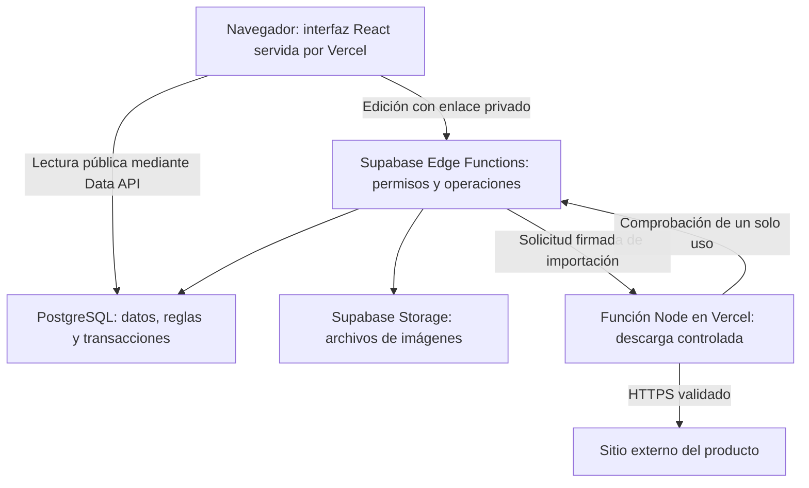

# Cómo se construyó Amigo Secreto 2026

Guía didáctica preparada el **1 de noviembre de 2026**. Explica el trabajo de T00 a T25 y las decisiones detrás del producto. Puedes leerla por bloques: primero el mapa general y después los temas que quieras entender mejor. El [avance del plan](implementation-progress.md) y el [resultado productivo](production-deployment-result.md) conservan las evidencias detalladas.

La pregunta que conecta todo el proyecto es: **¿cómo permitir que una persona edite sus deseos fácilmente, sin cuentas convencionales, conservando los datos y limitando lo que puede hacer cada enlace?**

### Recorridos de lectura

- [Producto, arquitectura y etapas](#1-qué-producto-construimos): para entender el mapa general.
- [Datos, enlaces y seguridad](#4-cómo-se-guardan-y-relacionan-los-datos): para comprender dónde se guarda cada cosa y quién puede modificarla.
- [Guardado, imágenes e importación](#7-qué-ocurre-cuando-pulsas-guardar): para seguir operaciones de principio a fin.
- [Cuotas, experiencia de uso y pruebas](#10-cuotas-errores-y-experiencia-de-uso): para entender cómo tratamos errores y comprobamos resultados.
- [Rendimiento, publicación y recuperación](#13-qué-se-optimizó-y-cómo-se-midió): para comprender cómo se preparó el producto para alojarlo.
- [Cierre y lectura del código](#16-qué-significa-que-el-código-esté-terminado): para continuar aprendiendo en el repositorio.

## 1. Qué producto construimos

La aplicación tiene tres experiencias principales:

- Un catálogo público de participantes y sus ideas de regalo.
- Un perfil con tres espacios para deseos, foto o ilustración, mensaje y preferencias.
- Un panel de organizador para administrar participantes, evento y enlaces de edición.

Un participante entra mediante su enlace privado. El organizador utiliza otro enlace con permisos administrativos. El catálogo se puede consultar sin esos enlaces.

El nombre «Amigo Secreto» no implica que el proyecto haga un sorteo: el alcance implementado es el catálogo y su administración. No se implementaron asignaciones de personas, reservas de regalos ni envío automático de notificaciones.

**Idea importante:** definimos las funciones del producto antes de construir su infraestructura. Eso permitió comprobar si cada tarea aportaba algo al alcance acordado.

## 2. El mapa de la aplicación

La interfaz que ves es una parte del sistema. Otras partes comprueban permisos, guardan datos, procesan fotos o descargan información de tiendas.



El dibujo omite detalles del transporte para facilitar la lectura. PostgreSQL se consulta a través de servicios/API; el navegador no abre una conexión administrativa a la base.

| Pieza | Qué hace aquí | Dónde verla |
| --- | --- | --- |
| React | Construye pantallas a partir de componentes y estado. | [Aplicación](../src/app/App.tsx) |
| TypeScript | Comprueba que los datos se usen de forma coherente durante el desarrollo. | Archivos `.ts` y `.tsx` de `src`, `server` y funciones. |
| Vite | Ejecuta el entorno de desarrollo y genera los archivos optimizados del frontend. | [Configuración](../vite.config.ts) |
| React Router | Decide qué pantalla mostrar según la ruta. | [Rutas](../src/app/App.tsx) |
| CSS y Tailwind | Definen presentación, disposición, tamaños y adaptación a pantallas. | [Sistema visual](ui-system.md) |
| Supabase | Proporciona PostgreSQL, API, ejecución Edge y almacenamiento de archivos. | [Integración](supabase-integration.md) |
| Vercel | Sirve el frontend y ejecuta el adaptador Node de importación. | [Adaptador](../api/fetch-product.ts) |
| Docker | Permite reproducir servicios y ensayos locales en entornos separados. | [Operación local](operations.md) |

**Node y Deno son entornos de ejecución de JavaScript/TypeScript.** No son nuevas versiones de React ni bases de datos. El adaptador de Vercel usa Node; las Edge Functions de Supabase utilizan su runtime basado en Deno. Esa diferencia fue relevante para la importación de productos.

### Cómo orientarte en las carpetas

| Carpeta o archivo | Para qué sirve |
| --- | --- |
| `src/pages` y `src/components` | Pantallas y piezas visuales reutilizables. |
| `src/hooks` | Coordinación de estado y comportamiento de formularios. |
| `src/domain` | Reglas y transformaciones del dominio, separadas de la pantalla. |
| `src/services` | Comunicación con APIs y tratamiento de respuestas. |
| `supabase/functions` | Código de servidor para accesos, imágenes e importación. |
| `supabase/migrations` | Evolución ordenada de la estructura y reglas SQL. |
| `server/product-fetch` y `api` | Descargador seguro y su adaptación a Vercel. |
| `tests` y `supabase/tests` | Pruebas de reglas, interfaz, base y permisos. |
| `scripts` | Herramientas de preparación, pruebas y mantenimiento con destinos acotados. |
| `docs` | Explicaciones, procedimientos y resultados. |
| `artifacts` y `backups` | Evidencias generadas y respaldos locales, ignorados por Git. |

Separar estas responsabilidades ayuda a cambiar una pantalla sin reescribir las reglas SQL, o a probar una regla sin abrir el navegador.

## 3. Cómo se construyó por etapas

Las tareas T00–T25 fueron una secuencia de trabajo, no veintiséis aplicaciones diferentes.

| Etapas | Trabajo principal | Por qué se hizo en ese orden |
| --- | --- | --- |
| T00–T03 | Plan, preparación técnica y reglas de datos. | Aclarar lo que debía aceptar el producto antes de persistirlo. |
| T04–T08 | Esquema SQL, permisos, datos de prueba, enlaces y operaciones protegidas. | Construir una base consistente antes de conectar formularios. |
| T09–T13 | Sistema visual, catálogo, perfiles, navegación privada y editor de regalos. | Convertir las reglas en recorridos utilizables. |
| T14–T18 | Imágenes, cuotas, importación y edición de perfil. | Resolver operaciones que combinan varios servicios y pueden tardar o fallar. |
| T19–T20 | Backend y panel del organizador. | Administrar personas y enlaces desde el producto. |
| T21–T23 | Accesibilidad, integración/seguridad y rendimiento. | Revisar el comportamiento completo y medir sus límites. |
| T24–T25 | Operación, recuperación, staging y producción. | Publicar una versión comprobada con destinos y evidencias identificables. |

Las verificaciones no comenzaron al final. Se fueron ampliando a medida que aparecían funciones nuevas. En ocasiones una decisión inicial quedó condicionada a un experimento: por ejemplo, el descargador Node se incorporó después de comprobar las limitaciones del transporte en Edge.

## 4. Cómo se guardan y relacionan los datos

Una base relacional organiza información en tablas y define relaciones entre ellas. Aquí conviene distinguir dos grupos:

| Grupo | Tablas | Qué representan |
| --- | --- | --- |
| Información de la aplicación | `public.participants`, `public.gifts`, `public.event_settings` | Personas, deseos y configuración del evento. |
| Control interno | `private.access_tokens`, `private.rate_limits`, `private.media_assets`, `private.media_deletions`, `private.import_requests` | Accesos, cuotas, ciclo de archivos y reservas de importación. |

Un **esquema** como `public` o `private` es una forma de agrupar objetos dentro de PostgreSQL. El nombre por sí solo no concede o retira permisos: eso se configura expresamente.

Cada participante tiene un identificador interno y un `slug`. El identificador se usa para relaciones; el slug permite una dirección legible, como `/participante/alguien`. Los regalos se relacionan con el identificador del participante y ocupan posiciones de 1 a 3.

### Las reglas no viven únicamente en los formularios

La interfaz puede impedir enviar un título vacío, pero una persona también puede construir una solicitud fuera de esa interfaz. Por eso aplicamos validación en varias capas:

1. El formulario ofrece ayuda y errores comprensibles.
2. El servidor valida formato, permisos y operación solicitada.
3. PostgreSQL protege las relaciones y restricciones de los datos guardados.

Ejemplos de mecanismos SQL utilizados:

- **Clave primaria:** identifica una fila.
- **Clave foránea:** evita relaciones inválidas, como un regalo asociado a una persona inexistente.
- **Restricción única:** impide duplicidades que contradicen el modelo, como dos regalos en una misma posición de una persona.
- **CHECK:** exige que un valor cumpla una regla.
- **Índice:** ayuda a localizar filas sin recorrer toda la tabla; tiene un coste al escribir y debe responder a una necesidad.
- **Trigger:** ejecuta una comprobación o acción vinculada a un cambio en la base. Se utiliza, entre otras cosas, para proteger asociaciones de imágenes.

Puedes empezar por el [esquema inicial](../supabase/migrations/20261026000100_wishlist_schema.sql). Los detalles de escrituras están en [operaciones protegidas](protected-mutations.md).

### Qué es una migración

Una migración es un archivo que expresa un cambio de estructura o de reglas SQL. Su historial permite saber qué cambios se registraron en cada entorno.

Al publicar, producción **ya tenía las catorce migraciones del proyecto**. Se compararon versiones y contrato, y se encontró que no había pendientes. Por eso no se reaplicaron. «Publicar una versión nueva» no equivale a «ejecutar otra vez todos los SQL».

Un **seed** prepara datos de ejemplo. Se utilizó una demo local con personas y regalos para desarrollar y probar. Ese contenido no se insertó en producción. El esquema, los datos de demostración y los datos reales tienen propósitos distintos.

## 5. Cómo funcionan los enlaces privados

Elegimos acceso por **capacidad**: poseer un enlace entrega un conjunto acotado de permisos. No hay un registro convencional de correo y contraseña para los participantes.

La capacidad contiene un token aleatorio de 256 bits, representado como 43 caracteres. La longitud y aleatoriedad dificultan adivinar un token válido.

El enlace personal tiene permiso sobre su participante. El enlace del organizador permite administrar el evento y sus participantes. La clave pública de Supabase que utiliza el navegador no sustituye esos permisos de edición.

### Qué ocurre al abrir el enlace

1. El token está en el fragmento de la URL, después de `#`.
2. El navegador no envía ese fragmento como parte de la solicitud HTTP normal.
3. La aplicación lo extrae y limpia la URL antes de mostrar la experiencia privada.
4. Conserva la credencial en memoria y consulta al servidor para validar su alcance.
5. Las operaciones privadas envían la credencial en una cabecera específica al endpoint correspondiente.

Retirar el fragmento evita que quede visible en la barra mientras se utiliza la aplicación. La credencial no se guarda en `localStorage` o `sessionStorage`. Por eso **recargar elimina el acceso de esa pestaña** y debes reabrir tu enlace conservado.

Esto es independiente del login de la CLI: la CLI autentica al desarrollador frente a Vercel/Supabase; el enlace privado autentica el acceso de una persona dentro de la aplicación.

### Por qué la base guarda un hash

PostgreSQL conserva SHA-256 del token. Al verificar una petición, se calcula el hash del token recibido y se contrasta con el registro correspondiente. Se comprueban además revocación, vencimiento y pertenencia.

Un hash permite comparar; **no permite recuperar el token original**. Para invalidar un enlace se revoca su registro. Para sustituirlo se genera otro token. Emitir un nuevo enlace personal o rotar el organizador retira la validez del anterior según las operaciones implementadas.

El acceso productivo inicial se conservó además cifrado localmente con Windows DPAPI. Ese archivo sí necesita poder descifrarse para abrir el enlace: es un propósito diferente al hash de la base.

| Mecanismo | Para qué se utilizó |
| --- | --- |
| Token aleatorio | Credencial que permite actuar con un alcance determinado. |
| SHA-256 del token | Verificarlo sin almacenar el token original en PostgreSQL. |
| SHA-256 de un archivo | Comprobar que su contenido sigue siendo el mismo. No lo cifra. |
| DPAPI | Conservar secretos recuperables cifrados para este usuario/equipo Windows. |
| HMAC | Verificar autenticidad e integridad de mensajes entre servidores que comparten un secreto. No cifra su contenido. |

Un enlace privado es transferible: quien lo recibe puede ejercer sus permisos. El perfil y las fotos siguen siendo públicos según el diseño; lo privado es la capacidad de editar, no la consulta del catálogo.

Código para seguir este recorrido: [tokens](../supabase/functions/_shared/tokens.ts), [navegación privada](private-navigation.md) y [sesión del cliente](../src/services/private-session.ts).

## 6. Qué protege cada capa de seguridad

**Autenticar** es comprobar una credencial. **Autorizar** es decidir si esa credencial puede realizar una acción sobre un recurso concreto. Un token válido de una persona no autoriza a editar a otra.

| Capa | Qué aporta aquí |
| --- | --- |
| Validación del formulario | Ayuda al usuario a corregir datos antes de enviarlos. |
| Autorización en Edge/SQL | Comprueba token, rol, propietario, vigencia y operación. |
| Grants | Determinan qué acciones puede ejecutar un rol sobre tablas, esquemas o funciones. |
| RLS | Establece políticas de acceso a filas; habilitarla sin políticas aplicables niega acceso por esa vía. |
| CORS | Controla qué orígenes pueden leer respuestas desde otros sitios en el navegador. No autentica a una persona ni bloquea por sí solo clientes externos al navegador. |
| CSP | Restringe recursos, scripts y conexiones que puede usar la página. Se configuró para el backend exacto de cada entorno. |

Se utilizó **defensa en profundidad**: varios controles cubren fallos distintos. Un botón oculto no sustituye una comprobación del servidor, y una CSP correcta no sustituye los permisos SQL.

### Tres nombres que pueden confundirse

| Nombre | Ejemplo del proyecto | Dónde se ejecuta |
| --- | --- | --- |
| Función/componente React | `CataloguePage` | Navegador; prepara la interfaz. |
| Edge Function | `wishlist-api` | Servidor Supabase; recibe HTTP y coordina operaciones. |
| Función SQL o RPC | `server_admin` | PostgreSQL; realiza una operación con reglas y transacciones. |

Las RPC públicas de servidor no son de libre ejecución para el cliente. Sus permisos se limitaron a los roles previstos. Las rutinas usan `SECURITY INVOKER`: trabajan con los privilegios del rol que las llama, en lugar de elevar automáticamente los privilegios al propietario de la función. También se fijó su `search_path` para evitar depender de resoluciones de nombres inesperadas.

Los tres handlers Edge usan `verify_jwt=false` porque la aplicación tiene sus propias capacidades, en vez de sesiones convencionales de Supabase Auth. **La autorización sigue siendo obligatoria dentro del handler y de sus operaciones SQL.** Se comprobó que las solicitudes sin capacidad fueran rechazadas.

Las claves de servidor como `service_role` tienen privilegios amplios. No se incorporan al frontend. Las variables `VITE_*` se consideran públicas porque Vite puede compilarlas dentro de los archivos que descarga el navegador.

Más detalle: [revisión de seguridad](security-review.md) y [entornos](environment.md).

## 7. Qué ocurre cuando pulsas Guardar

Supongamos que una persona cambia el título de un regalo.

1. Lo escrito vive inicialmente en un **borrador del formulario**.
2. La validación local muestra campos que deben corregirse.
3. El cliente envía la operación, la capacidad y la versión del registro que estaba editando.
4. El servidor comprueba acceso y contenido.
5. PostgreSQL valida y aplica el cambio dentro de una transacción.
6. La respuesta confirmada permite actualizar la pantalla y mostrar «guardado».

Una **transacción** agrupa operaciones SQL para confirmar un resultado coherente o revertirlo si falla. Por ejemplo, no debe quedar una operación parcialmente aplicada dentro de esa unidad de trabajo.

### Dos personas o dos pestañas editando a la vez

El registro lleva una versión. Imagina esta secuencia:

| Paso | Pestaña A | Pestaña B |
| --- | --- | --- |
| Carga | Lee versión 4. | Lee versión 4. |
| Primer guardado | Guarda indicando versión 4; el registro pasa a 5. | Todavía edita su borrador de la versión 4. |
| Segundo guardado | Ya tiene su cambio confirmado. | Envía versión 4 y recibe conflicto, en lugar de borrar silenciosamente el cambio de A. |

Esto se llama **control de concurrencia optimista**. La interfaz conserva el borrador y ofrece revisar el estado actual.

También se probaron carreras que requieren coordinación SQL: revocar un enlace mientras se guarda, o reclamar una foto para limpieza mientras otro proceso intenta asociarla. Los bloqueos y el orden en que se toman ayudan a que cada resultado sea coherente.

### Si se corta la respuesta

Que el navegador reciba un timeout no demuestra que PostgreSQL no guardó: la operación pudo completarse y perderse la respuesta. Por eso hay estados de resultado incierto y revisión/reconsulta. Un reintento sin comprobar el estado puede repetir una acción que ya sucedió.

Guías: [editor de regalos](gift-editor.md), [perfil](profile-editor.md) y [administración](organizer-panel.md).

## 8. Por qué las imágenes tienen un proceso especial

Una imagen combina archivos, permisos, memoria de procesamiento y referencias en la base. Guardar una URL en una tabla no resuelve todo ese ciclo.

Para archivos subidos, el servidor:

1. Comprueba acceso, participante, propósito y cuotas.
2. Inspecciona el contenido real; no confía solamente en la extensión o MIME declarado.
3. Rechaza formatos o estructuras no admitidos y entradas demasiado grandes.
4. Decodifica los píxeles, aplica la orientación y reduce las dimensiones cuando hace falta.
5. Recodifica a WebP y guarda un objeto nuevo con una ruta generada por el servidor.
6. Permite asociarlo al perfil o regalo cuando se confirma el formulario.

Se aceptan JPEG, PNG y WebP estáticas, con límites de entrada de 3 MiB y 16 millones de píxeles. Las salidas se reducen a un lado mayor de hasta 512 px para avatar y 1200 px para regalo, sin ampliar imágenes pequeñas. Los códecs se incluyeron con sus licencias y hashes; se ejecutan mediante WebAssembly en la función de imágenes.

**WebAssembly**, en este caso, permite ejecutar los códecs preparados para ese formato dentro del runtime. No significa que el navegador sea la autoridad que normaliza o autoriza el archivo.

### Subir una imagen y guardar el formulario son pasos distintos

La subida prepara un archivo pendiente. Guardar establece su asociación definitiva. Si cancelas el formulario, la foto anterior sigue siendo la del registro.

PostgreSQL y Storage son servicios distintos: una transacción SQL no puede deshacer mágicamente todos los pasos de Storage. Se implementaron reservas, confirmación de carga, comprobación de referencias y una cola de limpieza con reintentos.

Antes de borrar un archivo, la limpieza lo reclama y vuelve a comprobar si alguien lo está usando. Esa reclamación evita que una respuesta atrasada vuelva a asociar una ruta retirada. No se borra precipitadamente una foto por haber fallado una respuesta HTTP.

**Alcance operativo:** existe código y ensayo de limpieza con destinos locales acotados. Eso no implica que se haya programado un cron automático productivo. Un mantenimiento remoto necesita su procedimiento de servidor revisado; no se convierte el script local en remoto cambiándole una URL.

Una imagen indicada mediante URL externa sigue dependiendo del sitio que la aloja. No adquiere las mismas garantías de disponibilidad que un archivo almacenado por la aplicación.

Detalle: [imágenes y limpieza](media-upload.md).

## 9. Cómo se importa información de una tienda

El importador busca sugerencias: título, imagen, precio u otros metadatos disponibles. La interfaz permite revisar y aplicar campos al borrador. **Importar no equivale a guardar el regalo.**

El contenido de una tienda se trata como información externa no confiable. El HTML se analiza en el servidor; no se inserta como HTML ejecutable dentro de la aplicación. Además, no todas las tiendas ofrecen datos utilizables, por lo que existe una alternativa manual.

### El riesgo SSRF, explicado con un ejemplo

Si un servidor acepta cualquier URL y la descarga sin restricciones, alguien puede intentar que consulte una dirección interna en vez de una tienda. Eso es **SSRF**: utilizar al servidor para realizar solicitudes que el atacante no podría hacer directamente.

Por eso se validan HTTPS, dominio, puerto, resultados DNS y redirecciones, y se rechazan direcciones internas o reservadas. También hay límites de tiempo, saltos y bytes.

Una dificultad adicional es que un dominio puede resolver primero a una IP aceptable y luego a otra. El descargador fija la conexión a una IP que ya validó, conservando la comprobación TLS del nombre original.

### Por qué apareció una función Node adicional

Se probó el runtime Edge real. Con las APIs ensayadas no se demostró el control necesario sobre la conexión manteniendo la verificación del hostname. En vez de asumir que funcionaría igual en todos los runtimes, se comprobó una alternativa en Node y se separó únicamente la descarga.

La autorización y el análisis de metadatos siguen en Supabase. El adaptador Node no recibe el enlace privado del participante ni una clave administrativa de la base.

### Firmas y solicitudes de un solo uso

1. Edge autoriza al participante y pide una reserva temporal en PostgreSQL.
2. Envía al descargador una solicitud firmada con HMAC, URL, vencimiento y **nonce** aleatorio.
3. Node consulta mediante un callback firmado si puede consumir esa reserva, antes de descargar.
4. PostgreSQL permite consumirla una sola vez, incluso si hay varios servidores trabajando.
5. Node firma la respuesta y Edge comprueba su integridad antes de analizarla.

Un nonce es un identificador impredecible para esa solicitud. Su registro y consumo impiden reutilizar una petición válida repetidamente; el simple hecho de generar un número aleatorio no lograría eso por sí solo.

Este protocolo usa HTTPS para el transporte. HMAC permite comprobar la firma; no cifra la URL ni sustituye HTTPS.

Guías: [transporte e importación](product-import.md) y [vista previa de resultados](product-import-ui.md).

## 10. Cuotas, errores y experiencia de uso

Una solicitud válida también consume recursos. Se implementaron límites compartidos y persistentes para restringir operaciones por ventanas de tiempo. Los contadores SQL coordinan varias instancias; un contador únicamente en memoria de un servidor no haría lo mismo.

Cuando se agota una cuota, la API devuelve `429` con información de espera. El cliente muestra el estado y evita reintentos automáticos que empeoren la situación. La modalidad por IP no se habilitó sin comprobar la identidad de las cabeceras del proveedor; permanece el modo previsto con protecciones por capacidad/globales.

| Estado HTTP | Significado habitual en este proyecto |
| --- | --- |
| 401 | No hay una capacidad utilizable: ausente, desconocida, vencida o revocada. |
| 403 | Operación, ámbito u origen no permitido. |
| 404 | Recurso o ruta no disponible. |
| 409 | Conflicto de versión/estado; también se usa en el transporte para una reserva no consumible. |
| 429 | Debes esperar por una cuota. |
| 503 | No se puede atender la operación con el servicio/configuración disponible. |

El código por sí solo no cuenta toda la historia: hay que interpretar la operación y su respuesta controlada. Los mensajes de pantalla evitan exponer consultas SQL, claves o trazas internas.

Detalle: [cuotas](rate-limits.md).

## 11. Interfaz, accesibilidad y los fallos que encontramos

Se crearon componentes para campos, botones, avisos, estados vacíos y diálogos. Compartir componentes permite mejorar una interacción en varios formularios sin repetirla de forma distinta en cada pantalla.

También se trabajaron navegación por teclado, foco, etiquetas, errores asociados a campos, avisos anunciables, contraste, zoom, reflujo y movimiento reducido. Una etiqueta ayuda a identificar un campo; `aria-describedby` puede asociarle una explicación o error. Un anuncio `role="status"` permite comunicar un resultado sin mover el foco.

La revisión incluyó pruebas automáticas, varios motores de navegador y el recorrido guiado con lector informado por ti. Esto aporta evidencia sobre esos recorridos; no se declaró una certificación universal de accesibilidad.

### «Guardé, pero no veo que haya pasado algo»

El mensaje existía al principio de algunos formularios, pero al guardar desde el final quedaba fuera de la ventana. Se cambió por una confirmación visible dentro del viewport, anunciable y con botón para ocultarla. No se mueve el foco y el aviso no desaparece por un temporizador.

La lección es que **una operación correcta necesita una respuesta perceptible**. Que la base tenga el dato no significa que la interacción esté terminada para la persona.

### El selector de archivos y la comprobación del acceso

Al volver del selector, el navegador recupera el foco. La aplicación puede aprovechar ese evento para revalidar el enlace. Se reprodujo una carrera: la carga de imagen veía la sesión momentáneamente en comprobación y lo interpretaba como acceso perdido.

La corrección hizo que la subida espere la comprobación pendiente y continúe solo si conserva la misma identidad y permisos. Un enlace realmente revocado sigue rechazándose. Esperar una verificación no equivale a omitirla.

Se añadió una prueba que reproduce el retorno de foco, además de verificar archivos, URLs e importación en staging con ambos roles. El mensaje inicial tampoco se tomó como prueba de que absolutamente todos los fallos externos tuvieran esa única causa.

### La foto deshabilitada al crear una persona

En un participante nuevo, primero hay que guardar el alta. El archivo necesita un participante persistido al que asociarse. Esa deshabilitación era el comportamiento previsto, distinto del fallo de la carrera anterior.

La lección es distinguir un bloqueo intencional que debe explicarse de un error de implementación que debe corregirse.

Resultados: [correcciones de guardado e imágenes](staging-feedback-result.md) y [accesibilidad](accessibility-review.md).

## 12. Qué significa «lo probamos»

Se utilizaron pruebas diferentes porque cada una detecta una clase de problema.

| Prueba | Pregunta que ayuda a responder |
| --- | --- |
| TypeScript | ¿Estamos utilizando estructuras y tipos de forma coherente? |
| Unitarias | ¿Una regla o transformación responde bien a entradas concretas? |
| SQL en PGlite | ¿Se comportan las reglas de PostgreSQL en ese entorno de prueba embebido? |
| PostgreSQL real local | ¿Se mantienen permisos, transacciones y bloqueos con el motor/roles y conexiones reales del ensayo? |
| HTTP y Storage | ¿Los servicios se comunican y rechazan accesos/archivos indebidos? |
| Concurrencia | ¿Qué ocurre si dos acciones relevantes se solapan? |
| Playwright/UI | ¿Una persona puede recorrer la interfaz y observar los resultados esperados? |
| Staging alojado | ¿Funciona la combinación real de proveedor, variables, CORS, Storage y transporte? |
| Smoke productivo | ¿La versión publicada responde y cumple las comprobaciones controladas acordadas? |

PGlite utiliza PostgreSQL mediante WebAssembly, pero no reproduce por sí solo toda la plataforma Supabase ni demuestra carreras entre conexiones independientes. Por eso se complementó con servicios y PostgreSQL reales.

Los escenarios negativos tuvieron un papel importante: enlace revocado, edición ajena, imagen falsa, versión antigua, origen no admitido, nonce repetido y respuesta atrasada. Una API segura debe rechazar correctamente, además de permitir lo válido.

Los ensayos destructivos trabajaron con datos sintéticos y pilas separadas. No se borraron datos reales para comprobar una restauración. Se controlaron puertos, procesos y recursos propios para no cerrar la previsualización o la base del usuario.

Hay cifras distintas de pruebas en documentos de etapas diferentes porque las suites crecieron y hubo ejecuciones completas y dirigidas. No deben sumarse como si representaran casos únicos. La fuente para el detalle es [resultados de validación](validation-results.md).

## 13. Qué se optimizó y cómo se midió

Se midieron tamaño de JavaScript, solicitudes y estabilidad visual, en condiciones definidas de móvil/escritorio, red y CPU. Las optimizaciones respondieron a esas mediciones.

- **Carga diferida:** las pantallas de organizador y edición se descargan cuando hacen falta.
- **Cliente público específico:** el catálogo utiliza PostgREST sin cargar de entrada módulos del SDK que no necesita, como Auth o Realtime.
- **Imágenes normalizadas:** reducen el tamaño que debe descargar el visitante.
- **Espacio reservado:** evita que la llegada de contenido desplace innecesariamente lo que ya estaba en pantalla.
- **Prioridad de la primera imagen relevante:** ayuda a que se solicite antes cuando es importante para la vista.

Dos métricas usadas fueron **LCP**, relacionado con cuándo aparece el contenido principal visible, y **CLS**, que mide inestabilidad por desplazamientos de la página. Se conservaron condiciones y evidencias para comparar.

Las mediciones locales controladas y las de staging aportan evidencia bajo esas condiciones. No son estadísticas de visitantes reales de producción ni garantizan el mismo resultado para cualquier red o catálogo futuro.

Detalle: [rendimiento](performance-review.md).

## 14. Cómo pasamos de local a producción

| Entorno | Propósito |
| --- | --- |
| Vista temporal | Revisar presentación con datos preparados, sin credenciales ni persistencia real. |
| Local persistente | Trabajar con servicios y base locales. |
| Entornos de ensayo | Ejecutar pruebas aisladas, incluidos fallos y recuperación. |
| Staging | Probar una versión alojada con proyectos y secretos propios. |
| Producción | Servir la aplicación real a sus usuarios. |

Staging se preparó en proyectos Supabase y Vercel separados de producción. No bastaba con una URL de preview que siguiera escribiendo en la base real. También se separaron claves, HMAC y orígenes.

### Build, despliegue y dominio son conceptos diferentes

El **build** convierte el código fuente en archivos preparados para ejecutar/servir. El **despliegue** coloca una versión en la infraestructura. El **dominio** determina con qué dirección pública accedes a ella.

Un despliegue puede estar construido correctamente y su dominio todavía no apuntarle. También puede aparecer ACTIVE una función de servidor que no tenga las variables necesarias para atender su operación.

En producción encontramos precisamente servicios Edge sin variables de aplicación y un frontend que no tenía un despliegue funcional publicado en su dominio canónico. Se configuraron cinco variables Vercel y siete Edge, se verificó el backend y se publicó el frontend.

### Por qué fijamos Node 24.x

El proyecto Vercel se ajustó a Node 24, pero el primer build eligió Node 26 por el rango `>=24` del paquete. Se fijó `24.x` en `package.json` y en el paquete raíz del lockfile, y se comprobó el runtime efectivo del nuevo build.

`package.json` expresa dependencias y condiciones del proyecto. `package-lock.json` registra la resolución de dependencias para reproducir instalaciones. Mantenerlos coherentes reduce diferencias entre «mi equipo funciona» y «el proveedor construyó otra combinación».

### Verificar antes de asignar el dominio

Se construyó con `--skip-domain`, se verificó la URL inmutable y después se promovió/asignó el dominio canónico. El acceso temporal utilizado para comprobar el build protegido se revocó al terminar.

La lista de alias automáticos de Vercel no describió por sí sola toda la asignación final. Se comprobó el recurso específico del alias y el HTTP real. También se observó que Auth recuperó URLs anteriores después de los builds: se reaplicó la configuración prevista y se verificó nuevamente después de publicar.

La lección es **comprobar el estado final efectivo**, no dar por hecho que un comando exitoso completó todas las piezas del recorrido.

Un caso posterior reforzó esa lección: la configuración del primer despliegue estaba en un archivo local ignorado por Git. Al publicarse automáticamente un commit, Vercel no recibió aquellas reglas y los enlaces privados devolvieron 404 antes de llegar a React. Se añadió `vercel.json` en la raíz, con una prueba que comprueba su equivalencia con la configuración prevista. La [corrección documentada](routing-git-deployment-fix.md) distingue «funcionó mi despliegue manual» de «el repositorio contiene lo necesario para reproducirlo desde Git».

### Qué es un manifiesto de entrega

Se registraron rutas y SHA-256 de archivos para relacionar una versión con el contenido revisado. Eso permitió detectar cambios, excluir credenciales/respaldos de la subida y distinguir el código publicado de un directorio de trabajo que puede seguir cambiando.

Git conserva historial del código cuando se hacen commits. El build y el proveedor conservan otros artefactos y despliegues. Publicar no crea automáticamente un commit ni hace push: durante el cierre documentado no se realizaron esas acciones de Git.

Resultados concretos: [publicación productiva](production-deployment-result.md).

## 15. Logs, respaldos y recuperación

Los **logs** registran actividad. Se revisaron estados HTTP, severidad, errores runtime y marcadores sensibles en ventanas acotadas, guardando agregados en vez de volcar registros privados completos.

Se encontró un ejemplo de por qué hace falta interpretar la evidencia: ciertos metadatos contenían el prefijo de una clave. Se comprobó su longitud truncada sin descargar el valor completo; no se confundió ese prefijo con una clave íntegra expuesta.

Los **asesores** también requieren interpretación. Las tablas privadas sin políticas de cliente respondían al acceso previsto de servidor. Los avisos sobre índices son datos para revisar planes y volumen; no justifican conceder acceso o retirar índices automáticamente para vaciar una lista.

### Respaldar datos y respaldar archivos

PostgreSQL conserva filas y referencias. Storage conserva bytes de imágenes. Respaldar solamente la base no conserva por arte de magia los archivos a los que apuntan sus rutas. Además, funciones desplegadas, variables y configuración pertenecen a otras piezas de la recuperación.

Se preparó un respaldo lógico cifrado de producción y se comprobó su restauración en una instancia PostgreSQL local aislada. Se compararon datos, historial y permisos. El origen tenía Storage vacío en ese momento, de modo que no había bytes de imágenes productivas que exportar.

El ensayo local utilizó una simulación mínima de plataforma. Demostró recuperación lógica en ese destino; no fue una restauración completa alojada de todos los servicios Supabase. Los bundles Edge y ajustes anteriores se preservaron por separado.

DPAPI permite que este usuario/equipo Windows descifre el material conservado. No es automáticamente portable a cualquier ordenador. La copia externa quedó pendiente por tu decisión y no cambia el alcance de las funciones implementadas.

### Volver a un frontend anterior no vuelve atrás toda la aplicación

Un rollback del frontend puede cambiar qué archivos sirve Vercel. No revierte por sí mismo filas SQL, secretos, imágenes o funciones Edge. Antes de volver a una versión hay que comprobar que siga siendo compatible con el backend actual.

Guías: [recuperación](backup-recovery.md) y [despliegue/rollback](deployment-review.md).

## 16. Qué significa que el código esté terminado

Significa que el alcance acordado se implementó, se verificó con las pruebas documentadas y se publicó. No significa que cualquier cambio futuro sea innecesario o que todos los proveedores y tiendas externas se comportarán siempre igual.

En el cierre de publicación se dejó un organizador activo y el catálogo productivo sin participantes/regalos añadidos automáticamente. Esa es una fotografía del cierre, no una afirmación de que tu base siga vacía después de que la utilices.

Los recorridos completos de guardado/fotos/importación se comprobaron en staging. En producción se verificaron publicación, lectura, acceso administrativo, CSP, rechazos y transporte operativo sin crear participantes de prueba. Mantener ese límite evitó introducir datos ficticios para aparentar una prueba más amplia.

También hay una diferencia entre **tener una herramienta implementada** y **tener un proceso operativo continuo configurado**. Por ejemplo, hay ensayos y código de recuperación/limpieza, pero no se afirmó una restauración alojada completa o un mantenimiento automático productivo que no se ejecutó/configuró.

## 17. Cómo aprender recorriendo este repositorio

Puedes hacer estas lecturas sin operar sobre la base remota:

1. Abre [CataloguePage](../src/pages/CataloguePage.tsx). Identifica cómo decide mostrar carga, error, tarjetas o estado vacío. Relaciona cada rama con algo que ves en pantalla.
2. Abre [la consulta del catálogo](../src/services/catalogue.ts). Localiza las dos solicitudes y observa cómo se transforman datos en el modelo que utiliza la página.
3. Lee [tokens](../supabase/functions/_shared/tokens.ts). Distingue generar, validar formato, calcular hash y construir enlace: son tareas diferentes.
4. Sigue una operación desde [la sesión privada](../src/services/private-session.ts) hacia [wishlist-api](../supabase/functions/wishlist-api/index.ts) y después consulta la guía de [mutaciones protegidas](protected-mutations.md).
5. Compara [la adaptación de Vercel](../api/fetch-product.ts) con [el proxy](../server/product-fetch/proxy.ts). El archivo de adaptación es pequeño porque la lógica comprobable está separada del proveedor.
6. Revisa [la configuración de hosting](../server/deployment-config.ts). Busca qué backend permite la CSP y cómo se separan las rutas SPA de `/api` y los assets.
7. Elige una prueba de [tests/unit](../tests/unit/) y otra de [tests/ui](../tests/ui/). Pregúntate qué puede demostrar cada una y qué queda fuera de su alcance.

Si quieres ejecutar comprobaciones locales sencillas, desde la raíz:

```powershell
npm.cmd run typecheck
npm.cmd run test:unit
npm.cmd run check:docs
```

La vista temporal se abre con `npm.cmd run preview:local`; utiliza datos preparados y no te concede un acceso ficticio de edición. Los comandos de migración, bootstrap, limpieza y recuperación tienen otros alcances: consulta su guía específica antes de utilizarlos.

Al leer cualquier archivo, intenta responder cuatro preguntas: **qué recibe, qué comprueba, qué cambia y qué devuelve**. Ese recorrido conecta la interfaz, el servidor y la base de datos sin tener que memorizar todas las herramientas a la vez.
